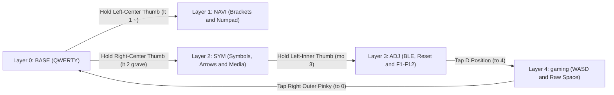

<picture>
  <source media="(prefers-color-scheme: dark)" srcset="/docs/images/TOTEM_logo_dark.svg">
  <source media="(prefers-color-scheme: light)" srcset="/docs/images/TOTEM_logo_bright.svg">
  
</picture>

# ZMK CONFIG FOR THE TOTEM SPLIT KEYBOARD

[Here](https://github.com/GEIGEIGEIST/totem) you can find the hardware files and build guide.\
[Here](https://github.com/GEIGEIGEIST/qmk-config-totem) you can find the QMK config for the TOTEM.

TOTEM is a 38 key column-staggered split keyboard running [ZMK](https://zmk.dev/) or [QMK](https://docs.qmk.fm/). It's meant to be used with a SEEED XIAO BLE or RP2040.


## HOW TO USE

- fork this repo
- `git clone` your repo, to create a local copy on your PC (you can use the [command line](https://www.atlassian.com/git/tutorials) or [github desktop](https://desktop.github.com/))
- adjust the totem.keymap file (find all the keycodes on [the zmk docs pages](https://zmk.dev/docs/codes/))
- `git push` your repo to your fork
- on the GitHub page of your fork navigate to "Actions"
- scroll down and unzip the `firmware.zip` archive that contains the latest firmware
- connect the left half of the TOTEM to your PC, press reset twice
- the keyboard should now appear as a mass storage device
- drag'n'drop the `totem_left-seeeduino_xiao_ble-zmk.uf2` file from the archive onto the storage device
- repeat this process with the right half and the `totem_right-seeeduino_xiao_ble-zmk.uf2` file.


---

## Personal Configuration Details


This fork customizes the 38-key **TOTEM** split keyboard for a **QWERTY** base layout with thumb-driven navigation, symbols, system/Bluetooth controls, and a dedicated low-latency gaming layer.

### Layer Overview (`config/totem.keymap`)

| Index | Label | Access | Summary |
| :---: | :--- | :--- | :--- |
| **0** | `BASE` | Default layer | **QWERTY** layout (with `V`/`C` swapped on bottom row), `Ctrl/Tab` outer-left pinky, `'` outer-right pinky, and hold-tap thumb keys (`LAlt/Backspace`, `NAVI/~`, `LShift/Space` \| `Right Alt`, `` SYM/` ``, `Delete`). |
| **1** | `NAVI` | Hold left-center thumb (`&lt 1 TILDE`) | **Left**: Paired brackets (`()`, `[]`, `{}`), `` ` ``/`~`, `=`, `+`, `-`, `_`, `PgUp`/`PgDn`, `LShift`, `LCtrl`. **Right**: Full **numpad** (`0`–`9`, `=`, `-`, `*`, `.`, `,`). |
| **2** | `SYM` | Hold right-center thumb (`&lt 2 GRAVE`) | Shifted top-row symbols (`! @ # $ % ^ & * ' "`), `\`, **Vim-style arrow row** (`← ↓ ↑ →` on right home row `H/J/K/L`), Right-Alt accented shortcuts (`RA(A)`, `RA(O)`, `RA(F18)`), `LWIN`, display brightness (`BRI_DEC`/`BRIGHTNESS_INC`), media controls (`Vol-/+`, `Prev/Next`, `Play/Pause`), and `&mo 3` trigger for `ADJ`. |
| **3** | `ADJ` | `SYM` → Hold left-inner thumb (`&mo 3`) | **Left**: `&sys_reset`, `&bootloader`, Bluetooth profile controls (`BT_CLR`, `BT_NXT`, `BT_PRV`), USB/BLE output toggle (`&out OUT_TOG`), and **Gaming layer toggle** (`&to 4`). **Right**: Function keys **`F1`–`F12`** in a 3×4 grid. |
| **4** | `gaming` | `ADJ` → Tap `D` position (`&to 4`) | Dedicated gaming layout with shifted ergonomic `WASD` (`0/Q/KP_3/E/R`, `LShift/A/W/D/F`, `Tab/LCtrl/T/S/G/B`), raw `Space` (zero hold-tap delay), `LAlt`/`LCtrl` thumbs, and exit back to `BASE` on right outer pinky (`&to 0`). |

### Layer Navigation Flow



---

### Combos

Key positions follow the 38-key TOTEM matrix (`0–4` / `5–9` top row, `10–14` / `15–19` home row, `20` left outer pinky, `21–25` / `26–30` bottom row, `31` right outer pinky, `32–34` / `35–37` thumbs):

| Combo Name | Keys (Positions) | Output | Timeout | Prior Idle | Scope |
| :--- | :--- | :--- | :---: | :---: | :--- |
| `combo_esc` | `Q + W` (`0 + 1`) | `Escape` (`&kp ESCAPE`) | `60 ms` | `120 ms` | All layers |
| `dash` | `; + '` (`19 + 31`) | `-` (`&kp MINUS`) | `70 ms` | — | All layers |
| `enter_right_combo` | `J + K + L` (`16 + 17 + 18`) | `Enter` (`&kp ENTER`) | `70 ms` | `100 ms` | All layers |

---

### Custom Hold-Tap Behaviors

Global `&mt` defaults are configured with `flavor = "tap-preferred"`, `tapping-term-ms = <170>`, `quick-tap-ms = <150>`, and `global-quick-tap`. Additionally, `config/totem.keymap` defines specialized hold-tap behaviors:

| Behavior | Flavor | Tapping Term | Quick Tap | Prior Idle | Notes |
| :--- | :--- | :---: | :---: | :---: | :--- |
| `mt_all` *(active)* | `balanced` | `175 ms` | `175 ms` | `35 ms` | `hold-trigger-on-release`; powers left outer-pinky and thumb mod-taps (`Ctrl/Tab`, `LAlt/Bspc`, `LShift/Space`). |
| `mt_left` / `mt_right` | `balanced` | `400 ms` | `170 ms` | `50 ms` | Bilateral `hold-trigger-key-positions` + `hold-trigger-on-release` (ready for timeless home-row mods). |
| `mt_shift_left` / `mt_shift_right` | `tap-preferred` | `175 ms` | `175 ms` | `20 ms` | Faster opposite-hand shift hold-taps for home-row Shift tuning. |
| `mt_thumb` | `balanced` | `100 ms` | `220 ms` | `0 ms` | Ultra-responsive thumb hold-tap profile. |
| `hold_sticky` | `hold-preferred` | `150 ms` | `220 ms` | — | Hold for `&kp`, tap for sticky key `&sk`. |

---

### Hardware, Firmware & CI Build Targets

- **Microcontroller**: Seeed XIAO BLE (`seeeduino_xiao_ble`), split wireless architecture with `totem_left` configured as Central (`CONFIG_ZMK_SPLIT_ROLE_CENTRAL=y`, BLE device name `TOTEM`) and `totem_right` as Peripheral.
- **Firmware Options (`config/totem.conf`)**: `CONFIG_ZMK_USB_LOGGING=n` (USB logging disabled for clean production builds).
- **West Manifest (`config/west.yml`)**: Pulls upstream `zmkfirmware/zmk` (`revision: main`).
- **GitHub Actions (`.github/workflows/build.yml`)**: Automatically builds firmware via `zmkfirmware/zmk/.github/workflows/build-user-config.yml@main` on `push`, `pull_request`, and manual `workflow_dispatch`.

#### Build Matrix (`build.yaml`)

| Board | Shield | Output Artifact | Purpose |
| :--- | :--- | :--- | :--- |
| `seeeduino_xiao_ble` | `totem_left` | `totem_left-seeeduino_xiao_ble-zmk.uf2` | Left half (Central) firmware |
| `seeeduino_xiao_ble` | `totem_right` | `totem_right-seeeduino_xiao_ble-zmk.uf2` | Right half (Peripheral) firmware |
| `seeeduino_xiao_ble` | `settings_reset` | `settings_reset-seeeduino_xiao_ble-zmk.uf2` | Clears stored BLE bonds / split pairing state |

### Repository Structure

```text
zmk-config-totem/
├── build.yaml                              # ZMK GitHub Actions build matrix
├── readme.md                               # Documentation & personal keymap reference
├── .github/workflows/build.yml             # Reusable ZMK firmware build workflow
├── docs/images/                            # TOTEM logos (light/dark) and layout SVG
└── config/
    ├── totem.keymap                        # Personal 5-layer keymap, combos & hold-tap behaviors
    ├── totem.conf                          # User Kconfig overrides (USB logging disabled)
    ├── west.yml                            # West dependency manifest (zmkfirmware/zmk)
    └── boards/shields/totem/               # TOTEM shield definition (DTSI, overlays, Kconfig)
```
